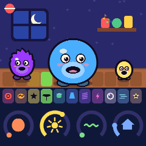
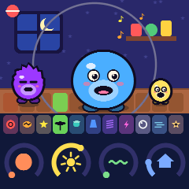
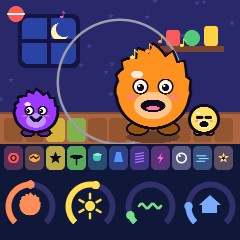
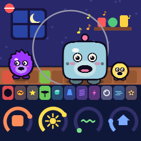
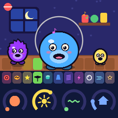
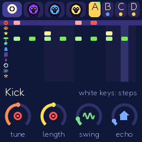
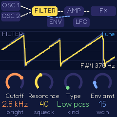

# BOP-1 for the M-VAVE FM-1

BOP-1 turns the M-VAVE FM-1 into a music toy for children that is also a real synthesizer. Switch it on and
music plays. Nothing a child can press sounds wrong, and every knob changes something they can see: a friend
whose body is the sound. The same toy grows with the child, from pressing things (age 3), to beats, loops and
songs (6 to 8), to a subtractive synth with its real names (9 to 12 and up), so they leave knowing what an
oscillator, a filter, an envelope and an LFO are.

| | |
|---|---|
| **[Try it in the browser](https://devrvega.github.io/BOP-1/emu/)** | The same code the FM-1 runs, with sound. No FM-1 needed. |
| **[Install it](https://devrvega.github.io/BOP-1/install/)** | From Chrome or Edge, with the FM-1 on USB. Nothing to install on the computer. |
| **[Read the manual](docs/MANUAL.md)** | For grown-ups: getting started, the four doors, the grown-ups' page, safety. |
| **[Printables](https://devrvega.github.io/BOP-1/print/)** | Picture stickers for the buttons, ten lesson cards for a class, quick guides. |
| **[Download](https://github.com/devrvega/BOP-1/releases/latest)** | The firmware file (`bop1-X.Y.Z.fwsc`) of every release, and its source. |

## The friends: bodies that are the sound

Each control has one meaning, the same everywhere:

| The sound | The friend |
|---|---|
| The waveform | Its body: sine a round blob, triangle pointy, saw spiky, square a boxy robot, noise a fuzzy cloud, and every blend between |
| The pitch | Its size: low is big, high is small; each note makes it bob |
| The filter's cutoff | Its mouth: closed and dark ("mmm") to wide open and bright ("aah") |
| The envelope | It hops as a note starts (the attack: how fast) and lands (the release: how slowly) |
| The LFO | It wobbles: bobbing (pitch), its mouth flapping (filter), fading (volume) |
| Echo and reverb | Its place: a bedroom, a cave, a canyon, outer space, with rings going out |
| The drums | The floor: a tile lights for each pad; the kick shakes the ground |

Eight friends to start: Bloop (sine), Pointy (a flute with vibrato), Zig (a saw lead), Bit (a square robot),
Wub (the bass monster), Twinkle (two oscillators a fifth apart), Bubbles (a resonant pluck) and Fizz (noise:
wind, waves, rain). Children make more in the Lab.

  

## The four doors

| Door | Ages | |
|---|---|---|
| **Play** | 3+ | The music is already playing. The white keys sing in the scale (no wrong notes), the black keys are drums and funny sounds (boing, laser, pop, whoosh, ta-da). ALGORITHM picks the friend, PRESETS the style (Bounce, March, Robot, Space, Lullaby, Dino Stomp, Jungle Party, Disco), SELECT the speed. FX is Surprise! (a new song); FX held and a white key is a magic trick (chipmunk, giant, robot, stutter, slow-mo, wah, rise, drop). REC is "Loop me". The key lights show the tune, to play along. |
| **Make** | 6–8 | Four layers like four friends in a band: Beats, Bass, Tune, Sparkle. Sixteen steps on the white keys, recording in time, "help me" ideas, parts A B C D chained into a song over happy, sad, brave or sleepy chords. Eight songs kept. |
| **Lab** | 9+ | The real synth: two oscillators, a filter (low, band, high pass), an envelope, an LFO, an arpeggiator and glide, echo, reverb and a bit-crusher. A signal-flow picture and a live scope; every knob shows its real name and the toy's word ("CUTOFF / bright"). Sounds made here become My Friends and play in Play and Make. Ten lessons, each with a try-it the firmware checks. |
| **Games** | all | Follow the lights (public-domain tunes), Copy me, High or low, Beat copy, Sound match, Name the friend. Stars fill a sticker book; nothing is ever taken away; no timers for the youngest. |

  

## Made for children

A grown-up's page (hold GLO and SAVE for three seconds) chooses which doors show (Play alone for a
three-year-old: then HOME does nothing and nobody gets lost), the volume cap, calm lights, the screen's
brightness, a sleep timer for bedtime, what happens when it's left alone, and whether music starts at
power-on. In the engine, always: a limiter that never lets the output past the cap; resonance and the
highest notes held back where children play; a fade in at the start. On the screen and the lights,
flashes are limited to three a second (none in calm mode), and a test measures it. Nothing is deleted with
a tap: EDIT is undo, and clearing needs it held (a ring fills).

## In short

| | |
|---|---|
| PLAY | The music on and off |
| HOME | The doors |
| Hold any button a second | A card says what it does here |
| EDIT · held | Oops (undo) · clear |
| SAVE | Keep this song (eight places) |
| GLO + SAVE, 3 seconds | The grown-ups' page |
| OCT− + OCT+, 5 seconds | Update mode |

## About it

BOP-1 is free software (GPL-3.0). It is built on [Felucca](https://github.com/hugelton/Felucca) by Leo
Kuroshita (@kurogedelic), Hügelton Instruments, by way of [X0X](https://github.com/charlesvestal/fm1-x0x),
[AMB-1](https://github.com/charlesvestal/fm1-amb), IND-1, LCD-4 and CRT-4. Children's synthesizers such as
Blipblox were an inspiration, in ideas only: BOP-1's friends, music, sounds and pictures are its own. See
[LICENSING.md](LICENSING.md); to build it, [BUILDING.md](BUILDING.md); to change it,
[CONTRIBUTING.md](CONTRIBUTING.md).

M-VAVE and FM-1 are trademarks of their owners. BOP-1 is independent: it is not affiliated with M-VAVE.
Installing firmware is at your own risk; the installer can put the stock firmware back.
