# BOP-1

BOP-1 turns the M-VAVE FM-1 into a music toy for children that is also a real synthesizer. Switch it on and
music plays. Nothing a child can press sounds wrong, and every knob changes something they can see: a friend
whose body is the sound. The same toy grows with the child, through four doors: **Play** (age 3 and up: press
things), **Make** (6 to 8: beats, loops, songs), **Lab** (9 to 12 and up: a real subtractive synth with its
real names, and lessons) and **Games**. This manual is for the grown-ups; the children need none of it.

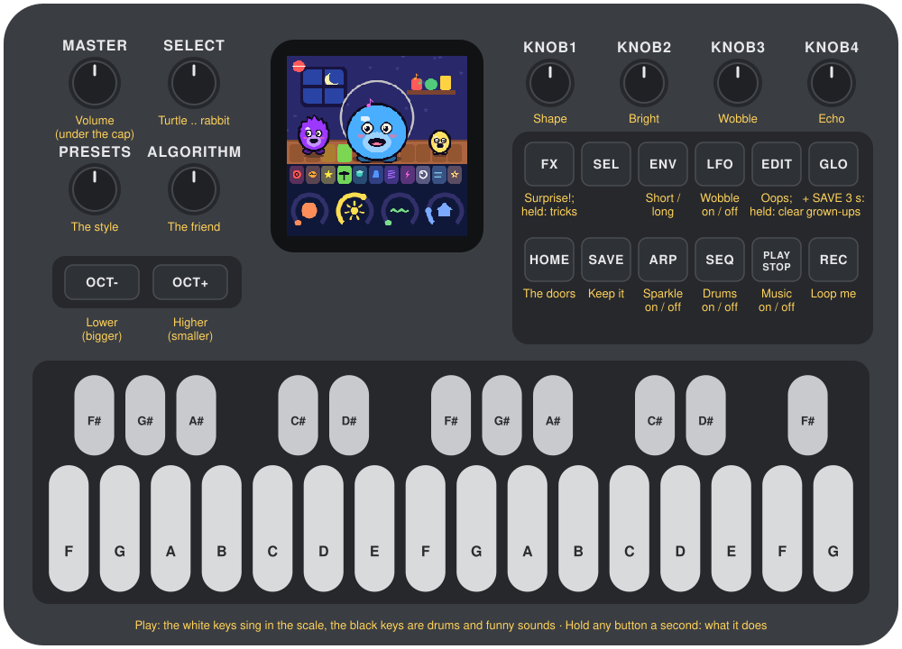

---

## Contents

1. Install
2. Getting started
3. The friends
4. Everywhere
5. Play
6. Make
7. Lab
8. Lessons
9. Games and the sticker book
10. The grown-ups' page
11. Safety
12. The lights
13. MIDI
14. Saving
15. Troubleshooting
16. Credits

---

## 1. Install

**Try it first:** [the browser emulator](https://devrvega.github.io/BOP-1/emu/) runs the same code with
sound, played with the mouse, a touch screen or the keyboard.

**Install from the browser:** open [the web installer](https://devrvega.github.io/BOP-1/install/) in
Chrome or Edge, connect the FM-1 with a USB data cable and press Install. Don't unplug it while it's
writing; when it finishes, the FM-1 restarts into BOP-1 and plays.

**Install from the command line:** download `bop1-X.Y.Z.fwsc` from the
[latest release](https://github.com/devrvega/BOP-1/releases/latest), install Python 3 with
`pip3 install mido python-rtmidi`, and from the BOP-1 source run:

```
python3 tools/fm1_install.py bop1-X.Y.Z.fwsc
```

**Which version:** the start screen shows it under the name, and the grown-ups' page at the bottom (About).

**Go back:** "Back to the stock firmware", at the bottom of the installer page, puts M-VAVE's firmware
back (download the FM-1 V15 file from the link there, choose it, press the button). M-VAVE's own
updater, M-UPGRADE, works too.

> Installing other firmware is at your own risk. If the FM-1 ever won't start, see
> [Recovering an FM-1 that won't start](#recovering-an-fm-1-that-won-t-start).

**Coming from another firmware:** BOP-1 keeps its settings where other firmwares keep theirs, under its own
name, and its songs, My Friends and the sticker book in the FM-1's main store (where some firmwares keep
samples or patterns). It never reads another firmware's: it starts fresh, and its first save replaces what
was kept there.

**The stickers:** the FM-1's buttons carry synthesizer names (ALGORITHM, ENV, LFO...). For children who
don't read yet, print the [sticker overlay](https://devrvega.github.io/BOP-1/print/stickers.html) on sticker
paper: a picture for each button and knob (what it does in Play), and the eleven pads for the black keys.

---

## 2. Getting started

**Before you hand it over (two minutes):**

1. Turn MASTER (the volume, top left) to the middle.
2. Hold **GLO** and **SAVE** together for three seconds: the grown-ups' page opens. For a child of three or
   four, set **Doors shown** to **Play only** (then HOME does nothing and they can't get lost). Check the
   **Volume cap** (70 % to start). Press **HOME** to close it.
3. That's all. Everything else is there to be found.

**The first five minutes, together:**

1. Switch it on. A song is already playing; the friend in the middle sings along.
2. Press the **white keys**: the friend sings, and every note fits the song. Press the **black keys**: drums
   and funny sounds.
3. Turn the four knobs on the right: the friend changes **shape** (knob 1), opens its **mouth** (knob 2,
   the sound gets brighter), **wobbles** (knob 3), and the **room** grows from a bedroom to outer space
   (knob 4, the echo).
4. Turn **ALGORITHM** for another friend, **PRESETS** for another style of music (the place changes),
   **SELECT** for slower or faster (a turtle or a rabbit).
5. Press **FX**: Surprise! A new song. Hold **FX** and press a white key: a magic trick while it's held.
6. Press **REC** and play: what you play goes round with the song ("Loop me"). REC again to stop.
7. Hold any button for a second: a card shows what it does.

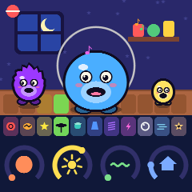

---

## 3. The friends

Every sound in BOP-1 is a friend, and the friend's body *is* the sound. Each control has one meaning, the
same in every door:

| The sound | The friend |
|---|---|
| The waveform | Its body: sine a round blob, triangle pointy, saw spiky with a zig-zag back, square a boxy robot with an antenna, noise a fuzzy cloud; turn slowly and it morphs |
| The pitch | Its size: low is big, high is small (OCT− and OCT+); each note makes it bob |
| The filter's cutoff | Its mouth: closed and dark ("mmm") to wide open and bright ("aah"), which is how a "wah" works |
| The envelope | It hops up as a note starts (the attack: how fast) and settles (the release: how slowly it lands) |
| The LFO | It wobbles at the LFO's speed: bobbing up and down (pitch: vibrato), its mouth flapping (filter: wah), fading in and out (volume: tremolo) |
| Echo and reverb | Its place: a bedroom, a cave, a canyon, outer space, with rings going out after each note |
| The drums | The floor: a tile lights for each pad; the kick shakes the ground |

| Friend | Its sound |
|---|---|
| **Bloop** (blue) | A sine: round and soft |
| **Pointy** (green) | A triangle: a flute, with a vibrato |
| **Zig** (orange) | A saw: a bright lead, two oscillators a little apart |
| **Bit** (silver) | A square: a robot, a little crushed |
| **Wub** (purple) | The bass monster: a saw over a sub-octave |
| **Twinkle** (yellow) | Two oscillators a fifth apart, like a bell |
| **Bubbles** (aqua) | A resonant pluck |
| **Fizz** (pink) | Noise through a ringing filter: wind, waves, rain |

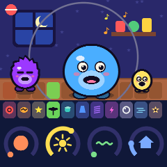 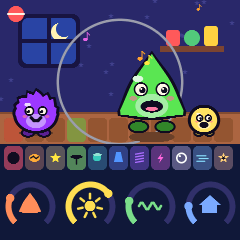 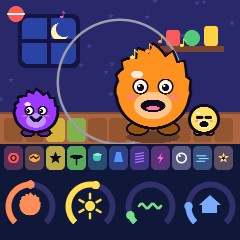 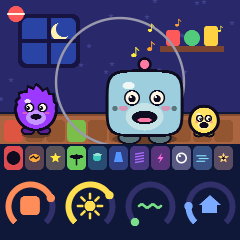

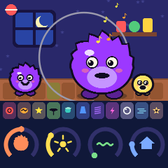 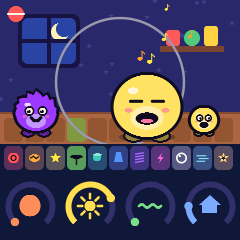 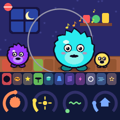 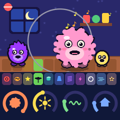

Sounds made in the Lab and kept as **My Friends** (up to eight, each with its colour) join them in every door.

---

## 4. Everywhere

| | |
|---|---|
| **PLAY** | The music on and off (in Games: hear it again) |
| **HOME** | The doors: a white key (1 Play, 2 Make, 3 Lab, 4 Games) or ALGORITHM picks one, the same key again or PLAY opens it; HOME again goes back |
| **Hold a button** | After a second, a card says what it does in this door (the Make and Lab cards add a sentence; the Lab's the real term) |
| **EDIT** | Oops: undoes the last big change (a loop, a Surprise, a cleared layer, a song opened). Held two seconds, a ring fills and it clears (Play: my loop; Make: this layer in this part; Lab: the friend's sound back) |
| **SAVE** | Keep this song: eight places, shown as their friends; a white key picks one. Turn ALGORITHM there to open a kept song instead (in the Lab, SAVE keeps the sound as a friend) |
| **GLO + SAVE**, 3 seconds | The grown-ups' page |
| **OCT− + OCT+**, 5 seconds | Update mode (for the installers) |

Nothing is deleted with a tap, and no screen can strand anyone: HOME always goes home.

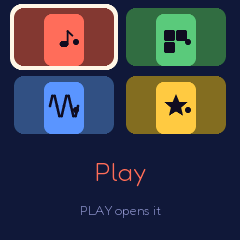 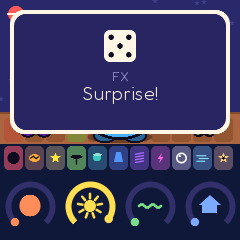 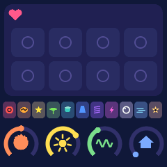

---

## 5. Play

*Ages 3 and up. No reading needed.*

The music is already playing when it switches on: a song made by BOP-1 in the style chosen. The friend sings
the tune; its band plays along: the bass friend on the left, the sparkle friend on the right, the drums on
the floor. When a child plays, the friend's own tune steps aside to let them sing, and the **key lights show
the song's tune**, so they can play along with the lights. The playhead runs dimly across the white keys.

| Control | Does | On the screen |
|---|---|---|
| White keys | The friend sings, in the scale (pentatonic: no wrong notes, about three octaves) | Notes fly out, coloured by their names |
| Black keys | Kick, snare, clap, hat, tom, cowbell, boing, laser, pop, whoosh, ta-da: louder than the song's own, which steps back a moment to let them through | A tile lights on the floor |
| ALGORITHM | The friend (the eight, then My Friends) | A new friend slides in |
| PRESETS | The style: Bounce, March, Robot, Space, Lullaby, Dino Stomp, Jungle Party, Disco (a new song in it, the friend kept) | The style's badge, top left |
| SELECT | Slower or faster | A turtle and a rabbit |
| Knob 1 **Shape** | The waveform: sine, triangle, saw, square, noise | The body changes shape |
| Knob 2 **Bright** | The filter: dark to bright | The mouth closes or opens |
| Knob 3 **Wobble** | The LFO (its speed follows) | It wobbles |
| Knob 4 **Echo** | Echo and reverb | Bedroom, cave, canyon, space |
| ENV | Short, medium or long notes (a plink, normal, a swell) | It hops, walks or floats |
| OCT− / OCT+ | An octave lower or higher | Bigger or smaller |
| SEQ | The song's drums on or off (the black keys still play) | |
| ARP | The sparkle on or off; with it on, the keys held run up and down | |
| LFO | The wobble on or off | |
| FX | **Surprise!** A new song in the same style (the friend and my loop kept) | A dice rolls |
| FX held + white key 1–8 | A trick while held: chipmunk, giant, robot, stutter, slow-mo, wah, rise, drop | |
| REC | **Loop me:** what you play (keys and pads) goes round over the song, two bars, in time; REC again to stop; again to add more | A red dot, the loop going round |
| EDIT | Oops (the last loop goes); held: my loop cleared | |
| SAVE | Keep this song | |

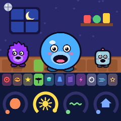 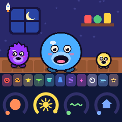 

**The places:** knob 4 takes the friend from a bedroom at night (a little echo) to a cave, a canyon at
sunset and outer space (the most).

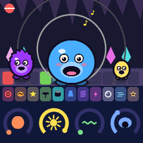 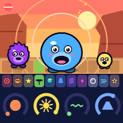 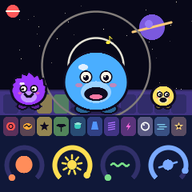

---

## 6. Make

*Ages 6 to 8. Beats, loops and songs.*

A song has **four layers**, like four friends in a band: **Beats** (the drums), **Bass**, **Tune** (the
friend) and **Sparkle** (arpeggios and chords). It has **four parts**, A B C D, each one bar long, played in
a chain; each part has its own chord, from the song's **chords** (happy, sad, brave or sleepy). The Bass and
the Sparkle follow the chords by themselves, so a line written once fits every part.

Make works on the song Play was playing (switch doors and it's the same song); SAVE keeps it.

| Control | Does |
|---|---|
| ALGORITHM | The layer: Beats, Bass, Tune, Sparkle (the tabs at the top) |
| PRESETS | Its friend (on Beats: the drum) |
| SELECT | The tempo |
| Knobs 1–4 | Shape, bright, wobble, echo, as in Play (on Beats: the drum's tune and length, the swing, the echo) |
| **Beats:** black keys | Pick the drum (and play it) |
| **Beats:** white keys | Its sixteen steps, on and off; ENV + a step: a loud one |
| **Bass, Tune, Sparkle:** keys | Play (in the scale); the black keys play the drums along |
| SEQ | The white keys become the sixteen steps: a tap puts the last note played on that step, or takes it away; hold a step and turn knob 1 for its note (along the scale), knob 2 for its length |
| REC | Records what you play into this layer of this part, in time; REC again to stop |
| FX | **Help me:** a new idea for this layer |
| SEL | This layer quiet, or back (its tab crossed out) |
| ENV · LFO · OCT | Short or long notes · the wobble · an octave down or up |
| ARP held + white keys 1–4 | The part to work on (it plays round and round); press several in a row (A A B A...) and let go: a song, played as a chain |
| GLO held + white keys 1–4 | The chords: happy (I–V–vi–IV), sad (vi–IV–I–V), brave (I–IV–V–I), sleepy (I–vi–IV–V) |
| GLO tapped | Hear this part alone, or the whole song |
| EDIT | Oops; held: this layer cleared in this part |

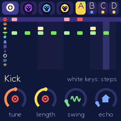 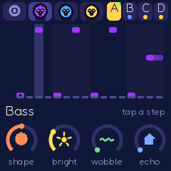 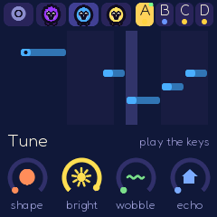

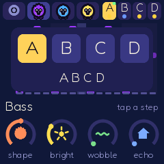 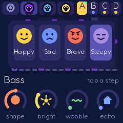

The key lights show the steps (the playhead runs through them) and, on Beats, the drum chosen.

---

## 7. Lab

*Ages 9 to 12 and up. The real synth, by its real names.*

The Lab's first screen offers the **synth** (white key 1) or the **lessons** (white key 2; see 8).

At the top, the **signal flow**: OSC 1 and OSC 2 into the FILTER, into the AMP, into the FX, with the
ENVELOPE and the LFO drawn as wires to what they move. The page open is lit. Under it, a **live scope** shows
the wave at that stage (after the oscillators, after the filter, after the amp), with the stage before it
ghosted, so the filter can be seen rounding off a saw. The envelope's page draws its shape, the LFO's its
wave. Each knob shows its real name, its value, and the toy's word ("Cutoff / 2.8 kHz / bright").

| Page (button) | Knob 1 | Knob 2 | Knob 3 | Knob 4 |
|---|---|---|---|---|
| Oscillators (SEL) | OSC 1 wave | OSC 2 wave | OSC 2 tune (semitones) | Mix 1 to 2 |
| ... again (SEL) | Sub-octave | Detune | Glide | Level |
| Filter (SEQ) | Cutoff | Resonance | Type (low, band, high pass) | Envelope amount |
| ... again (SEQ) | Key tracking | Envelope amount | Cutoff | Resonance |
| Envelope (ENV) | Attack | Decay | Sustain | Release |
| LFO (LFO) | Wave (sine, triangle, square, random) | Rate | Depth | Target: pitch, filter, volume |
| Arpeggiator (ARP) | Pattern (up, down, up and down, random) | Rate | Octaves | Glide |
| Effects (FX) | Echo time | Echo repeats | Reverb | Robot (bit-crush) |

| Control | Does |
|---|---|
| ALGORITHM | The layer whose sound you make: Tune, Bass, Sparkle |
| PRESETS | A friend (or one of My Friends) onto it, to start from |
| Keys | Play it, in the scale; **GLO** switches to a piano (every key its real note; the screen shows its name and frequency) |
| OCT− / OCT+ | An octave down or up (half or twice the frequency) |
| SAVE | Into **My Friends**: a white key picks the place, knob 1 its colour; it then plays in Play and Make |
| EDIT | Oops; held: the friend's own sound back |

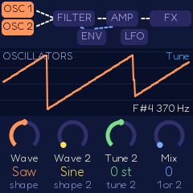 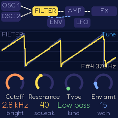 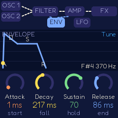

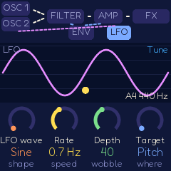 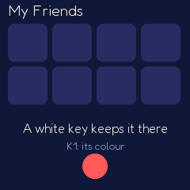 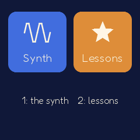

The Lab lets the resonance ring all the way (a squeal) unless the grown-ups' page says **Lab squeals:
never**; in Play and Make it is always held back.

---

## 8. Lessons

Behind the Lab door (key 2 on its first screen): ten short lessons, each a few picture cards and a **try it**
the firmware checks. OCT+ goes to the next card (after a try-it, once it's done), OCT− back. Finishing one
puts a sticker in the sticker book. The synth stays playable under them.

| | Lesson | Try it |
|---|---|---|
| 1 | What is sound? A wiggle in the air | Play a key and watch the wiggle |
| 2 | High and low: fast and slow wiggles, the frequency | A high key, then a low one |
| 3 | Shapes of sound: the same note, another wave | Knob 1 (Wave) to Square |
| 4 | The filter: taking the fizz out; resonance | Cutoff all the way down; then Resonance up |
| 5 | Envelopes: how a sound starts and stops | Attack up: a slow start |
| 6 | The LFO: a hand that keeps turning a knob | Depth up, and play |
| 7 | Two oscillators: detune makes it fat, a fifth bright | Detune up |
| 8 | Beats and steps: sixteen steps, the kick on 1 | White keys 1, 5, 9, 13 |
| 9 | Scales: the pentatonic, major and minor | Five different notes |
| 10 | Chords and songs | Three keys at once |

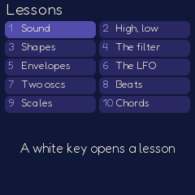 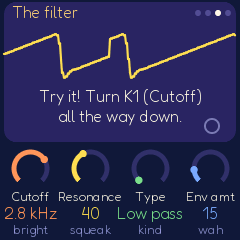

The [printable lesson cards](https://devrvega.github.io/BOP-1/print/lessons.html) give each one as a
classroom activity too, with and without the FM-1, and the real words to learn.

---

## 9. Games and the sticker book

White keys 1–6 pick a game (the same key again, or PLAY, starts it), 7 the sticker book. PLAY in a game hears
it again; HOME leaves. The song stops while the games play, and its sounds come back after.

| Game | Teaches | How |
|---|---|---|
| **1 Follow the lights** | Melody, the keyboard | A key lights: press it, and the tune comes out. Twinkle Twinkle, Hot Cross Buns, Mary Had a Little Lamb, Frère Jacques, Row Row Row Your Boat, Old MacDonald, Ode to Joy, Happy Birthday. A staff with coloured notes for those who read. No timer. |
| **2 Copy me** | Memory, pitch | The friend sings notes on four lit keys; sing them back; one more each time |
| **3 High or low?** | Pitch | Two notes: OCT+ if the second is higher, OCT− if lower (the big and small friends say so) |
| **4 Beat copy** | Rhythm | Hear a rhythm on the cowbell, four clicks, then tap it on any black key |
| **5 Sound match** | Synthesis | Turn the knobs until your friend sounds like the other (PLAY hears it): warm, warmer, hot. Shape first; then bright, short or long, and wobble as it goes on |
| **6 Name the friend** | Timbre | Hear a sound; which of the three friends made it? |

Each game gives one to three stars (always at least one); every five stars a new sticker. The sticker book
holds the eight friends, the eight styles and the ten lessons' stars. Nothing is ever taken away (only the
grown-ups' page can reset it).

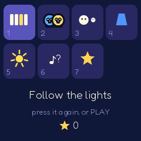 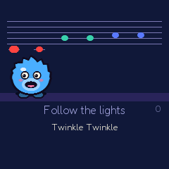 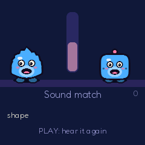

---

## 10. The grown-ups' page

Hold **GLO** and **SAVE** together for three seconds. **SELECT** (or ALGORITHM) moves, **knob 1** (or
PRESETS) changes, **HOME** closes it and keeps the settings.

| Setting | Choices | |
|---|---|---|
| Doors shown | Play only, + Games, + Make, all four | Play only: HOME does nothing |
| Volume cap | 10–100 % (70 %) | The most the output can ever reach, whatever MASTER says |
| Lights | full, calm, off | Calm: no flashes, no chases, no button pulses; off: only PLAY |
| Screen | 1–4 | Brightness |
| Sleep timer | off, 5, 10, 20, 30 minutes | From switching on: the music stops and the screen dims (after half a minute untouched). Any key wakes it. Bedtime: pick the Lullaby style first |
| Idle | dim, then stop / always on | The screen dims after two minutes untouched; the music stops after ten |
| At power-on | music / quiet | |
| Lab squeals | allowed / never | Never: the Lab holds the resonance and the highest notes back too |
| Keys to USB MIDI | on / off | The notes played, to a computer |
| MIDI channel | 1–16 | |
| MIDI clock | follow / lead | Follow another's clock, or send ours |
| Tune | ±50 cents | |
| Reset: songs, My Friends, sticker book | hold SAVE 3 s | Each on its own |
| About | | The version, the battery reading, how to reach update mode |

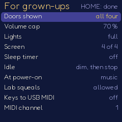

---

## 11. Safety

- **The volume cap** limits the output, and an always-on **limiter** keeps it under the cap whatever the
  MASTER knob, the song or the effects do (a test checks it at every setting, on the heaviest song).
- **No squeals:** in Play and Make the filter's resonance is held well below self-oscillation and the
  highest notes are folded down an octave. The Lab can go further unless the grown-ups' page says never.
- **A gentle start:** the sound fades in at power-on and after a sleep.
- **Flashes:** whole-screen and whole-panel light flashes are limited to three a second (the WCAG 2.3.1
  threshold); with Lights: calm there are none, and no chases. A test measures every scene's brightness
  frame to frame and fails above the limit.
- **Nothing lost by a tap:** EDIT is undo; clearing needs EDIT held two seconds, the resets three.
- **No reading needed** in Play; the [picture quick-start](https://devrvega.github.io/BOP-1/print/quickstart.html)
  and the stickers help the youngest.

---

## 12. The lights

| Where | The keys | The buttons |
|---|---|---|
| Play | The song's tune (play along), the keys held, the playhead dimly | Pulse with the kick (at most three a second); SEQ, ARP, LFO lit when on; PLAY green, red while Loop me records |
| Make | The steps of the layer (the playhead through them), the drum chosen | The layer's state |
| Lab | The keys held | The page's button bright, the other pages dim |
| Games | The next note (Follow the lights), the choices (Copy me, Name the friend) | |

A rainbow runs across the keys at power-on, after Surprise! and when stars are won (not with Lights: calm).

---

## 13. MIDI

USB and the TRS MIDI input (with the FM-1's adapter): notes on any channel play the friend; channel 10 plays
the pads (General MIDI drum notes: kick 36, snare 38, clap 39, hat 42, tom 45, cowbell 56, and 49, 51, 37,
46, 57 for the funny sounds). MIDI clock in drives the song (MIDI clock: follow), or BOP-1 sends its own
(lead). With Keys to USB MIDI on, the notes played go out on the channel chosen.

---

## 14. Saving

- **The song** (the one playing and being made) is kept by itself, a few seconds after a change when the music
  is stopped, and when changing doors; switching off and on comes back to it.
- **Eight kept songs:** SAVE shows them; a white key keeps the song there. Turn ALGORITHM or PRESETS and the
  same screen opens one instead (a white key: that song). EDIT undoes an open.
- **My Friends** (eight sounds) and the **sticker book** are kept as they change.

Saving to the FM-1's memory takes a moment in which the sound pauses, so BOP-1 saves while the music is
stopped, or when asked.

---

## 15. Troubleshooting

**Update mode:** hold OCT− and OCT+ together for five seconds. A countdown appears; let go before it ends to
cancel.

**Calibration:** if a button or knob does the wrong thing, hold OCT− and OCT+ while you switch the FM-1 on.
The screen then asks you to press each button and turn each knob in turn.

**Clicks or dropouts:** the most BOP-1 can be asked for is every pad on every step with chords on every step
and every effect up. If the FM-1 ever runs short, BOP-1 plays fewer notes at once (the tune first, then the
sparkle, then the pads) until it has time again.

**After a crash:** BOP-1 shows a red CRASH screen and restarts by itself a few seconds later. The next start
shows RESTARTED AFTER A CRASH and an address (PC ...) for a moment. If you report the problem, include that
address and what was happening.

**Safe mode:** if BOP-1 crashes twice in a row while starting, it starts in SAFE MODE instead. There's no
sound, but USB works, so the web installer can reach it: reinstall BOP-1, or put the stock firmware back from
the same page. Press PLAY to try starting BOP-1 normally again. If even safe mode fails twice, the FM-1 drops
into the chip's own update mode, and only the rescue below can reach it.

### Recovering an FM-1 that won't start

An FM-1 in the chip's own update mode shows a blank screen, and neither the web installer nor M-VAVE's
updater can see it. A script in the BOP-1 source puts M-VAVE's firmware back, on a Mac, with the USB cable you
already have. In Terminal, from the BOP-1 folder:

```
bash tools/fm1_rescue.sh
```

1. If a window asks to install the command line developer tools, click Install. When it has finished, run
   the line again.
2. If it asks for a password, type your Mac password (nothing shows as you type) and press Return.
3. When it says it's waiting, plug the FM-1 in and switch it on. The script catches it, checks the chip,
   saves a backup of the FM-1's memory in the `fm1-rescue` folder in your home folder, and asks before it
   writes anything.
4. Type **yes** and press Return. Don't unplug anything until it says it's restarting the FM-1. The FM-1
   then starts into its original firmware, and you can install BOP-1 again from there.

The script downloads M-VAVE's FM-1 V15 firmware and JieLi's flash loader, and checks both against known
fingerprints. It writes only the firmware area of the memory, never the bootloader or the FM-1's own
settings, and checks everything it writes. Running it again is always safe. If the FM-1 never shows up at
all, Felucca's [FM-1-transporter](https://github.com/kurogedelic/FM-1-transporter) (a small RP2040 board
wired to the USB lines) can still reach it.

---

## 16. Credits

BOP-1 is free software under the GNU General Public License, version 3. If you share the firmware, you must
also share its source code.

- BOP-1 is built on CRT-4 and LCD-4, themselves built on IND-1 and on
  [AMB-1](https://github.com/charlesvestal/fm1-amb) by Charles Vestal: the engine's frame, the drums, the
  plate reverb, the screen and knob code, the simulator and the browser emulator.
- The platform (the FM-1's drivers, USB, storage, updates, the installers) is
  [Felucca](https://github.com/hugelton/Felucca) by Leo Kuroshita (@kurogedelic), Hügelton Instruments, by way
  of [X0X](https://github.com/charlesvestal/fm1-x0x) and FoMni.
- Children's synthesizers such as Blipblox inspired BOP-1's ideas (music at power-on, generated melodies,
  nothing that sounds wrong, lights with the music, a toy that grows into a synth). Only ideas: BOP-1's
  friends, music, sounds and pictures are its own.
- The games' tunes are traditional or in the public domain.
- The screen's face is Fredoka (SIL Open Font License).
- The idea of running FM-1 firmware in the browser comes from [Groove OS](https://www.groove-os.com/).

M-VAVE and FM-1 are trademarks of their owners. BOP-1 is independent: it is not affiliated with M-VAVE.
